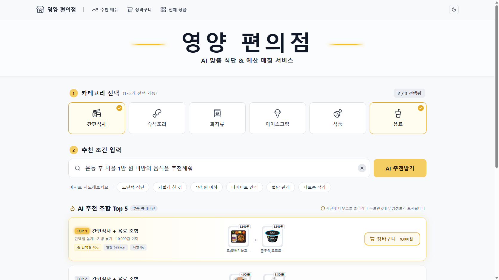

# 영양 편의점 (Pick CU)

평소 말투로 상황과 예산을 말하면, CU 상품 조합 **Top 5**를 영양 합계와 함께 추천하는 서비스입니다.

**🔗 프로젝트 페이지: https://hayoung-create.github.io/PickCU/**



## 한눈에 보기

- **입력:** "운동 끝나고 5천원으로 먹을 거 추천해줘" + 카테고리(간편식사, 음료)
- **결과:** 단백질 높고 지방 낮은 상품 조합 5개와 합계 가격·영양 정보
- **원칙:** LLM은 문장을 조건으로 바꾸는 일만 하고, 가격과 영양 합계는 DB 값으로 코드가 계산합니다.

| 항목 | 내용 |
| --- | --- |
| 기간 | 2026.10.28 – 11.10 (10일) |
| 팀 | 팀 아이넷 4명 (K-Digital Training LLM 과정) |
| 내 역할 | **박하영 · 자연어 처리(LLM) 담당** |

## 내가 맡은 일

사용자 문장에서 **영양 성분 2개와 방향(높음/낮음)** 을 뽑는 모델과, 팀원이 바로 쓰는 함수 `parse_query`를 만들었습니다.

```python
parse_query("5천원 이하로 운동 후에 먹을 거")
# {"budget": 5000, "nutrients": {"단백질": "high", "지방": "low"}}
```

- `skt/A.X-4.0-Light`(7B)를 **QLoRA**(4bit NF4 + LoRA r16)로 파인튜닝
- 학습 데이터 설계·정제 (94상황 × 30문장 = 2,820문장)
- 프롬프트만 개선했을 때 44% 근처에서 멈춘 정확도를 파인튜닝으로 **86.1%** (dev)까지 개선
- 예산 금액은 모델 대신 규칙 코드로 추출
- 인사·잡담처럼 관계없는 문장은 추천하지 않도록 규칙 검사와 시스템 프롬프트로 차단

## 결과

| 지표 | 결과 |
| --- | --- |
| 문장 해석 정확도 (처음 보는 test 240문장) | **85.8%** (파인튜닝 전 62.5%, +23.3%p) |
| 성공 기준 | test 80% 이상 → 달성 |
| CU 상품 영양 DB | 2,154개 (영양성분표 이미지를 Vision LLM으로 판독) |
| 문장당 해석 시간 | 3.3초 → 0.81초 (양자화 후, RTX 4060) |

정확도는 영양소 2개와 방향이 모두 맞은 문장의 비율입니다(순서 무관).

## 기술

`Python` `SQLite` `A.X-4.0-Light` `QLoRA (PEFT)` `Qwen2.5-VL` `FastAPI` `React` `Ollama`

## 링크

- **프로젝트 페이지:** https://hayoung-create.github.io/PickCU/
- **전체 코드 (팀 저장소):** https://github.com/nnujabes/Pick_CU
- **내 작업 폴더:** https://github.com/nnujabes/Pick_CU/tree/main/members/hayoung
- **파인튜닝 어댑터 (Hugging Face):** https://huggingface.co/nnujabes/pickcu-ax-4.0-light-lora
- **발표자료 (PDF, 바로 보기):** [영양편의점_프로젝트_발표자료.pdf](%EC%98%81%EC%96%91%ED%8E%B8%EC%9D%98%EC%A0%90_%ED%94%84%EB%A1%9C%EC%A0%9D%ED%8A%B8_%EB%B0%9C%ED%91%9C%EC%9E%90%EB%A3%8C.pdf)
- **발표자료 (PPT):** [영양편의점_프로젝트_발표자료.pptx](%EC%98%81%EC%96%91%ED%8E%B8%EC%9D%98%EC%A0%90_%ED%94%84%EB%A1%9C%EC%A0%9D%ED%8A%B8_%EB%B0%9C%ED%91%9C%EC%9E%90%EB%A3%8C.pptx)

## 이 저장소의 파일

| 파일 | 내용 |
| --- | --- |
| `index.html` | 프로젝트 페이지 (GitHub Pages) |
| `images/` | 서비스 화면 캡처와 시연 영상 |
| `영양편의점_프로젝트_발표자료.pptx` | 최종 발표자료 |
| `영양편의점_프로젝트_발표자료.pdf` | 최종 발표자료 PDF (GitHub에서 바로 보기) |
